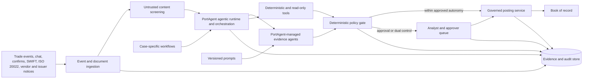

# PortAgent Architecture Baseline

## Purpose

PortAgent is the application's agentic runtime and orchestration layer. It selects and coordinates
the required agents, prompts, tools, and workflows for each case while preserving the boundary
between evidence interpretation and deterministic processing. Agents interpret ambiguous evidence;
deterministic components calculate, validate, and apply policy; humans decide exceptions; and a
separately privileged service performs posting. The application is not a book of record, and
PortAgent and its agents receive no ledger write capability.

## System context

## Backend boundaries

| Boundary | Responsibility | Prohibited responsibility |
|---|---|---|
| `api` | Authenticated case, evidence, audit, and decision endpoints that invoke application workflows | Agent logic, financial calculation, policy overrides, or direct ledger access |
| `application/agents` | PortAgent agent definitions that interpret ambiguous evidence and return structured, cited findings | Arithmetic, deterministic policy decisions, or posting |
| `application/prompts` | Versioned system and task prompts used by PortAgent-managed agents | Secrets, desk thresholds, executable policy, or mutable case state |
| `application/tools` | Bounded retrieval, content screening, schema validation, deterministic calculations, and deterministic policy-gate operations exposed to workflows | Unrestricted source access, subjective evidence selection, or agent-accessible ledger writes |
| `application/workflows` | PortAgent workflow definitions that select the case-specific agent composition and sequence screening, evidence interpretation, deterministic processing, policy evaluation, escalation, and approval handoff | Circumventing guardrails, policy outcomes, approval requirements, or the posting boundary |
| `config` | Environment-specific runtime settings, model routing, connector references, and desk/risk-owned policy parameters | Embedded secrets, business calculations, or hard-coded production thresholds |
| `data` | Optional non-sensitive synthetic fixtures and versioned evaluation inputs for local development and testing | Production case state, authoritative evidence, credentials, or a book of record |

An in-memory repository or seeded cases may be introduced as an optional local-development design,
but they are not assumed to exist and are not part of the production architecture. Production case,
approval, idempotency, and audit state requires concurrency-safe durable storage with unique
idempotency constraints, immutable audit append, and transactional decision handling.

## Agent roster

The PortAgent runtime composes the roster per case; more agents do not imply a better workflow.

| Agent | Used for | Output |
|---|---|---|
| Break classifier | Known trade-break classification | Break type and confidence |
| Trade evidence agent | Chronology and agreed terms in trader-broker communications | Structured terms, citations, conflicts |
| Confirmation extractor | Confirm or contract-note economics | Strict fields with page provenance |
| Corporate action extractor | SWIFT, ISO 20022, vendor, and issuer notices | Event fields with per-field provenance |
| Source reconciliation agent | Ambiguous semantic comparison only | Agreed, partial, or conflicting finding |

Standing settlement instructions, holdings, tax lots, entitlement arithmetic, fee differences,
rounding, withholding, eligibility, idempotency, and policy evaluation remain deterministic.

## Workflow baselines

### Trade break

1. PortAgent starts the applicable trade-break workflow after deterministic deduplication by
   idempotency key.
2. Screen every third-party evidence item before model access.
3. Classify the break; unknown types escalate.
4. Retrieve the bounded chat window, confirmation, booked trade, and SSI record.
5. Extract and reconcile agreed terms while preserving chronology and citations.
6. Treat a chat-confirm mismatch as a counterparty dispute.
7. Calculate and validate the proposed amendment deterministically.
8. Evaluate the external policy gate.
9. Auto-post only when policy permits; otherwise create a complete approval case.

### Corporate action

1. PortAgent starts the applicable corporate-action workflow and retains every available
   announcement source.
2. Screen and extract each source into the strict event schema.
3. Build a field-level golden copy without source precedence.
4. Escalate every conflicting field.
5. Query record-date positions and tax lots deterministically.
6. Calculate ratio, fractions, cash in lieu, and withholding in code.
7. Route all voluntary events to the desk; route mandatory events through policy.

### Approval and posting

1. Present the trace, proposed amendment, and side-by-side cited evidence.
2. Require an authenticated approver for every action.
3. Require a note for amend and reject; require the corrected value for amend.
4. Require two distinct identities for dual-control cases.
5. Make the final approval create a posting instruction for the separate posting service.
6. Reject duplicate decisions and reconcile the posting acknowledgement before completion.

## Target adapters

- Pub/Sub and Eventarc for events; Cloud Run for stateless services.
- Document AI and Cloud Storage for document capture and retained evidence.
- BigQuery, AlloyDB, and approved MCP connectors for grounded read access.
- Gemini models accessed through PortAgent model adapters for evidence interpretation; PortAgent
  remains the application runtime and orchestration layer.
- Model Armor plus application screening for untrusted content.
- Apigee, Workflows, and a separate workload identity for the posting boundary.
- Cloud Audit Logs and an immutable application audit store for reconstruction.
- IAM deny policies, VPC Service Controls, Sensitive Data Protection, and CMEK as required by the
  target environment.

## Non-functional baseline

- Fail closed when evidence, policy configuration, audit persistence, or posting acknowledgement is
  unavailable.
- Correlate all logs by case, workflow, evidence, and idempotency identifiers.
- Keep prompts, schemas, policy versions, model routes, and evaluation datasets versioned.
- Never log unrestricted source content or secrets; audit access is role-scoped.
- Replay historical resolved cases for prompt, model, retrieval, policy, or calculation changes.
- Block release on unexplained postings, duplicate-action defects, missing evidence, critical
  security findings, or precision below the risk-approved gate.
